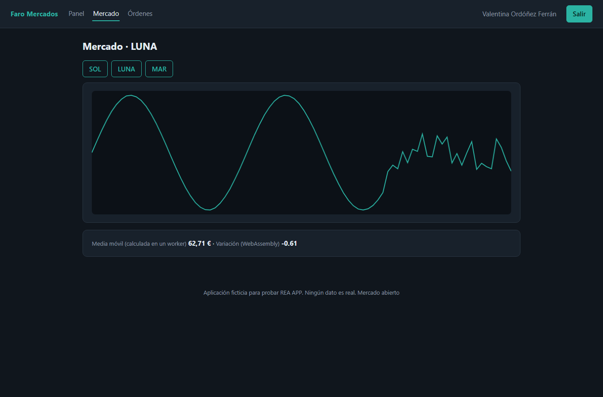
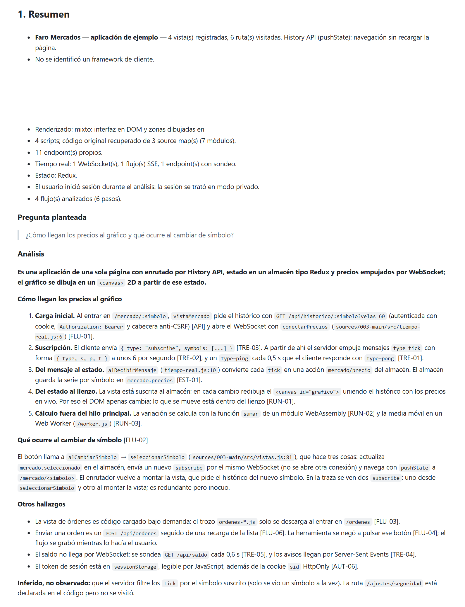
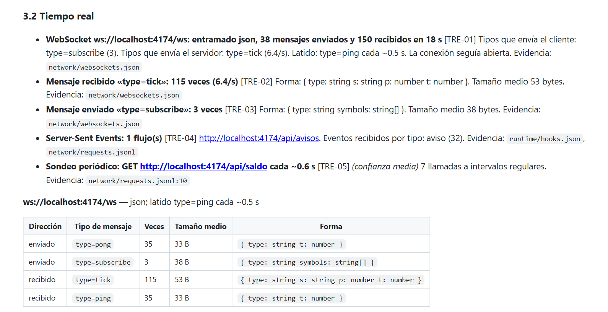
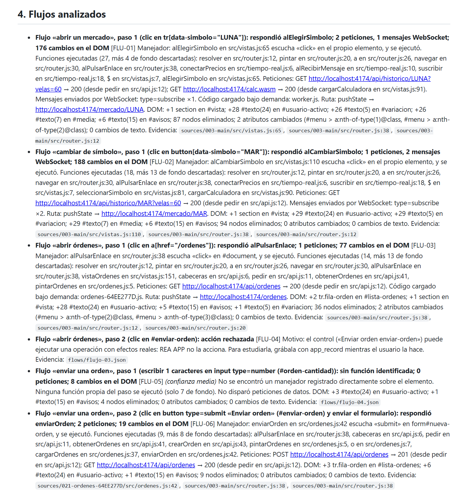

# REA APP

**Ingeniería inversa de aplicaciones web, con evidencia.** Un plugin de Claude Code (más un servidor MCP y una CLI) para entender cómo funciona una aplicación de verdad: una plataforma de gráficos, un editor en el navegador, un panel, una banca en línea.

```
/rea-app https://app.ejemplo.com
/rea-app https://app.ejemplo.com ¿cómo llegan los precios al gráfico?
```

Es la variante para aplicaciones de [REA WEB](https://github.com/pedromogollon3-coder/rea-web), que analiza páginas. Una página se entiende con una carga; una aplicación no: tiene sesión, muchas vistas, estado, datos en tiempo real y a veces dibuja en un lienzo. Por eso REA APP trabaja de otra manera:

- **Sesión viva.** El navegador queda abierto durante todo el análisis. Si la aplicación pide acceso, **tú inicias sesión a mano en esa ventana**. La herramienta nunca ve ni escribe tus credenciales.
- **Flujos grabados.** Usas la aplicación con normalidad y REA APP registra, gesto a gesto, qué funciones se ejecutaron, qué peticiones y mensajes salieron y qué cambió.
- **Lo propio de una aplicación.** Rutas, estado (Redux, Pinia…), protocolo del WebSocket, lienzos, WebGL, WebAssembly, workers y mecanismo de autenticación.

Inspirada en [morluto/rea](https://github.com/morluto/rea) (MIT). Código propio.

> [!IMPORTANT]
> Para **aplicaciones propias, autorizadas o de estudio**. Muchas (banca, corretaje) prohíben la automatización en sus condiciones de uso: comprobarlo es responsabilidad tuya. REA APP no introduce credenciales, no evade protecciones y no ejecuta operaciones. Lee los [límites éticos](#límites-éticos).

## Instalación

Necesitas [Claude Code](https://claude.com/claude-code) y Node.js 20 o superior.

```bash
claude plugin marketplace add pedromogollon3-coder/rea-app
```

```bash
claude plugin install rea-app
```

El servidor MCP viene empaquetado y arranca solo. La primera vez, si no hay un Chromium disponible, Claude ejecuta la herramienta `app_setup` para descargarlo (unos 150 MB).

<details>
<summary>Instalación manual, para desarrollo o para usar solo la CLI</summary>

```bash
git clone https://github.com/pedromogollon3-coder/rea-app.git
cd rea-app
npm install
npm run setup    # descarga el Chromium de Playwright
npm run build
```

Para probar el plugin desde la carpeta clonada, sin instalarlo: `claude --plugin-dir .`

</details>

## Ejemplo

El repositorio trae una aplicación de ejemplo, un terminal de mercados ficticio con acceso, rutas sin recarga, API autenticada, precios por WebSocket, un gráfico en `<canvas>`, WebAssembly y un worker:

```bash
npm run demo
```



En Claude Code:

```
/rea-app http://localhost:4174 ¿cómo llegan los precios al gráfico y qué ocurre al cambiar de símbolo?
```

Claude abre la aplicación y te pide que inicies sesión en la ventana (el usuario y la contraseña de prueba aparecen en el terminal de `npm run demo`). Después recorre las vistas, acciona lo que no tiene efectos, te pide que hagas tú lo que sí los tiene y escribe el informe:



El protocolo en tiempo real se describe por tipos de mensaje, con su frecuencia y su forma, nunca con su contenido:



Y cada paso de cada flujo indica qué código respondió. En este ejemplo la herramienta se negó a pulsar «Enviar orden» (paso rechazado) y ese flujo se grabó mientras lo hacía el usuario:



El informe completo está en [docs/ejemplo-informe/informe.md](docs/ejemplo-informe/informe.md). Se generó con `node scripts/demo-session.mjs`, que hace de usuario con las credenciales de prueba.

## Cómo se usa con una aplicación real

1. `/rea-app <url>`. Se abre una ventana de Chromium.
2. Si hay acceso, **inicia sesión tú** en esa ventana (incluida la verificación en dos pasos) y avisa a Claude. A partir de ahí el análisis pasa a **modo privado**.
3. Claude reconoce la aplicación y recorre las vistas. Lo que sea navegar, filtrar o abrir, lo acciona él.
4. Para lo que tenga efectos (una orden, una transferencia, guardar un documento) Claude te pide que lo hagas tú mientras graba. Usa un importe mínimo o un entorno de pruebas si lo hay.
5. Recibes `informe.md`. Al cerrar, el navegador se descarta: no se guarda ningún perfil ni sesión.

## Qué produce

Todo queda en `rea-app-out/<dominio>/<fecha>/`:

| Archivo | Contenido |
|---|---|
| `informe.md` | Resumen, arquitectura (rutas, renderizado, scripts, estado), datos y comunicación (API, tiempo real, autenticación, almacenamiento), flujos analizados, stack, evidencias por archivo y línea, incógnitas |
| `evidence.json` | Lo mismo, estructurado |
| `captura.har` | Tráfico de red con cabeceras, cookies y cuerpos enmascarados (se escribe al cerrar) |
| `views/` | Una carpeta por vista registrada: DOM y HTML |
| `flows/` | Un archivo por flujo, con el detalle de cada paso |
| `sources/` | Módulos originales recuperados de source maps, o el código embellecido |
| `network/requests.jsonl` | Una petición por línea (lo que citan los hallazgos) |
| `network/websockets.json` | Tipos de mensaje por conexión: frecuencia y forma |
| `runtime/`, `state/`, `storage/` | Instrumentación, forma del estado y claves de almacenamiento |

## Herramientas MCP

Todas devuelven `hallazgos`, su `evidencia` y `no_confirmado`.

| Herramienta | Qué hace |
|---|---|
| `app_open(url)` | Abre la aplicación y deja el navegador vivo. Detecta si pide acceso |
| `app_status` | Dónde está la aplicación, si el usuario ya inició sesión, si hay modo privado |
| `app_snapshot` | Registra la vista actual: estructura, selectores, estado |
| `app_act(acciones)` | Acciones guiadas (clic, escribir, tecla, hover, scroll, navegar) y análisis de lo que provocan |
| `app_record` | Graba un flujo que hace el usuario a mano y lo analiza paso a paso |
| `app_scripts` | Scripts, frameworks, source maps y código original |
| `app_routes` | Enrutador, rutas visitadas, rutas declaradas en el código y carga diferida |
| `app_api` | Endpoints con parámetros, esquema, autenticación, vista de origen y función que los llama |
| `app_realtime` | Protocolo de los WebSockets, Server-Sent Events y sondeo |
| `app_state` | Forma de los almacenes de estado y de la configuración global |
| `app_runtime` | Lienzos y su contexto, WebAssembly, workers y otras API |
| `app_auth` | Mecanismo de autenticación, sin secretos |
| `app_storage`, `app_stack` | Almacenamiento del navegador; tecnologías y cabeceras de seguridad |
| `app_report` | Arma `informe.md` y `evidence.json` |
| `app_close`, `app_setup` | Cierra el navegador; instala Chromium |

### Cómo relaciona un gesto con el código

Antes de que cargue la aplicación se instala una instrumentación que anota rutas, lienzos, WebAssembly, workers y gestos del usuario. Durante un flujo, el motor lee la cobertura de código de Chromium en ventanas cortas, descarta las funciones que también se ejecutan con la aplicación en reposo (temporizadores, animación) y cruza lo que queda con los manejadores de eventos del elemento, las peticiones, los mensajes de WebSocket enviados y los cambios en el DOM. Con source maps, cada función se cita por su archivo y línea originales.

Reconoce los entramados de WebSocket más habituales: JSON con campo de tipo, Socket.IO, SignalR, STOMP y el de longitud prefijada `~m~`. De los mensajes binarios solo conoce tamaño y frecuencia.

## CLI

Desde un clon del repositorio (el paquete no está publicado en npm):

```bash
node dist/cli.mjs explorar https://app.ejemplo.com
```

Abre la ventana y te deja dirigir el análisis desde el terminal: Enter registra la vista actual, `g` empieza o termina la grabación de un flujo, `q` termina y genera el informe.

```bash
node dist/cli.mjs analizar https://app.ejemplo.com
```

Análisis automático de la parte pública, sin intervención. `node dist/cli.mjs --help` lista el resto de subcomandos.

## Límites éticos

Están en el código, no solo aquí ([`policy.ts`](src/core/policy.ts), [`flow.ts`](src/core/flow.ts), [`redact.ts`](src/core/redact.ts), [`app-scripts.ts`](src/core/app-scripts.ts)):

- **Credenciales.** La herramienta no las pide, no las escribe y no las ve. `app_act` se niega a escribir en campos de contraseña, de pago o de verificación y a enviar un formulario de acceso. Las grabaciones anotan cuántos caracteres se escribieron, nunca cuáles.
- **Operaciones.** `app_act` no pulsa controles que parezcan comprar, vender, transferir, pagar, enviar, firmar, confirmar o eliminar. El filtro es deliberadamente amplio: a veces rechazará algo inofensivo, y entonces lo haces tú mientras se graba.
- **Barreras.** No evade CAPTCHAs ni protecciones anti-bot, no usa modo sigiloso y se identifica en el User-Agent (`rea-app/<versión>`). Si la aplicación bloquea navegadores automatizados, el análisis termina ahí.
- **Modo privado.** Se activa solo en cuanto inicias sesión: sin capturas de pantalla, con el texto visible del HTML sustituido por puntos y los números largos (cuentas, importes, identificadores en URLs) enmascarados. De las respuestas de la API y de los mensajes en tiempo real se guarda la forma, nunca los valores.
- **Sin persistencia.** No se guarda perfil, cookies ni sesión entre ejecuciones. Al cerrar, o si el proceso termina, el navegador se descarta.
- **Ritmo y robots.txt.** Las peticiones propias de la herramienta se espacian (500 ms por defecto) y robots.txt se respeta salvo que lo desactives para una aplicación propia.
- **Reimplementación, no copia.** Si pides reconstruir una funcionalidad, se escribe de nuevo con datos de prueba y un servidor simulado en local, sin copiar textos, marca ni código, y sin conectarse a la aplicación original.

### Lo que el enmascarado no garantiza

El modo privado reduce mucho lo que se guarda, pero no es una garantía absoluta. Los textos de botones y enlaces se conservan (hacen falta para describir la interfaz) y podrían incluir un dato tuyo si la aplicación lo pone ahí. Los nombres de claves, de campos y de rutas se guardan tal cual. Revisa la carpeta de salida antes de compartirla y no la subas a un repositorio público si viene de una sesión con datos reales.

## Preguntas frecuentes

**¿Puede analizar mi banco o mi bróker?**
Técnicamente sí, con tu sesión iniciada por ti. Antes, comprueba que sus condiciones lo permiten: muchas entidades prohíben el acceso automatizado y pueden bloquear la sesión. La herramienta no hará operaciones ni guardará tus datos, pero el tráfico lo genera un navegador automatizado.

**¿Y si la aplicación detecta el navegador automatizado y no me deja entrar?**
REA APP no intenta ocultarse. En ese caso no se puede analizar la zona privada.

**¿Qué pasa con aplicaciones que dibujan todo en un lienzo (editores, gráficos)?**
El contenido del lienzo no existe en el DOM, así que no hay elementos ni selectores. REA APP sí ve qué contexto usa (2D, WebGL, WebGPU), qué código dibuja, qué datos lo alimentan y qué hace cada gesto: por eso ahí conviene `app_record` en lugar de acciones guiadas.

**¿Y el código en WebAssembly o en workers?**
Del WebAssembly se obtiene la interfaz (qué importa y qué exporta), no su lógica. El código de los workers queda fuera de la cobertura de funciones. Ambos aparecen como incógnitas en el informe.

**¿Por qué rechazó un clic inofensivo?**
Porque el texto del botón coincide con el filtro de operaciones. Hazlo tú con `app_record`.

**¿Sirve para sitios sencillos?**
Sí, pero para una página sin sesión ni estado es más directo [REA WEB](https://github.com/pedromogollon3-coder/rea-web).

**El comando no aparece como `/rea-app`.**
Su nombre completo es `/rea-app:rea-app`. El corto funciona mientras no haya otro comando igual.

## Desarrollo

```bash
npm run build                  # tipos + empaquetado en dist/
npm test                       # Vitest: unitarias y de extremo a extremo contra la aplicación de ejemplo
node scripts/mcp-check.mjs     # servidor MCP empaquetado, por stdio
node scripts/demo-session.mjs  # sesión completa con acceso y genera un informe (--visible para verla)
```

`dist/` está versionado a propósito: el plugin se instala clonando el repositorio. Ejecuta `npm run build` antes de confirmar cambios en `src/`.

```
src/core/   motor: sesión viva (live), flujos (flow), instrumentación (app-scripts), análisis (appmap, network, scripts…), política y enmascarado
src/mcp/    servidor MCP (stdio)
src/cli/    CLI rea-app
skills/     skill /rea-app con el flujo de trabajo
examples/   aplicación de ejemplo usada por las pruebas
```

## Licencia

[MIT](LICENSE).
